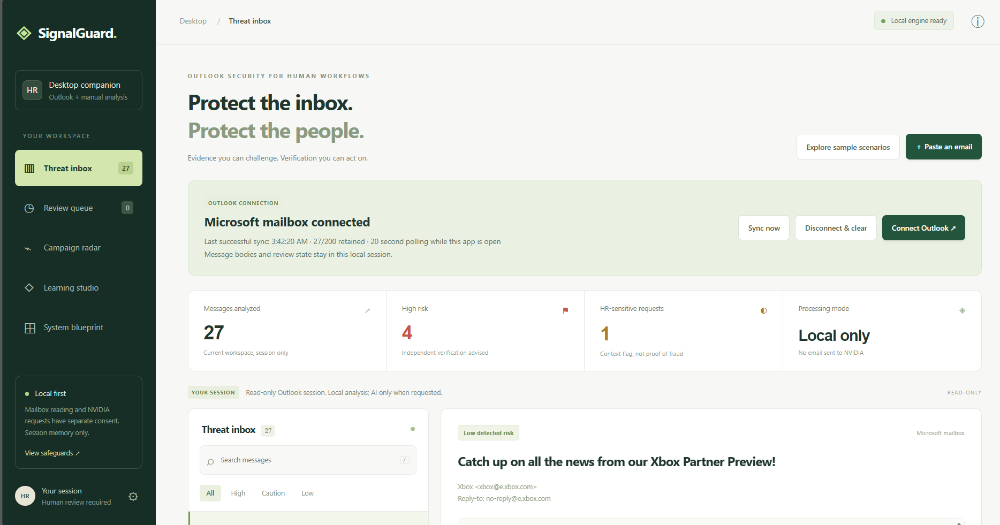
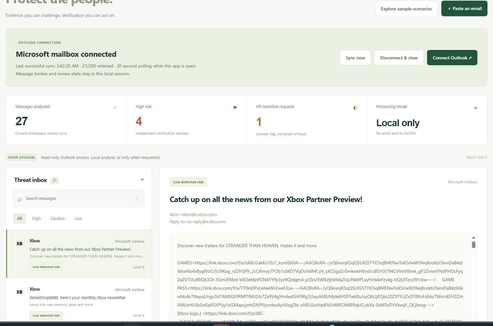
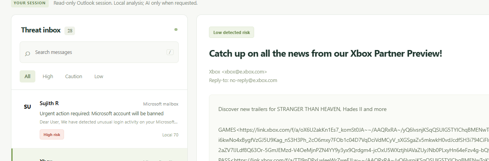
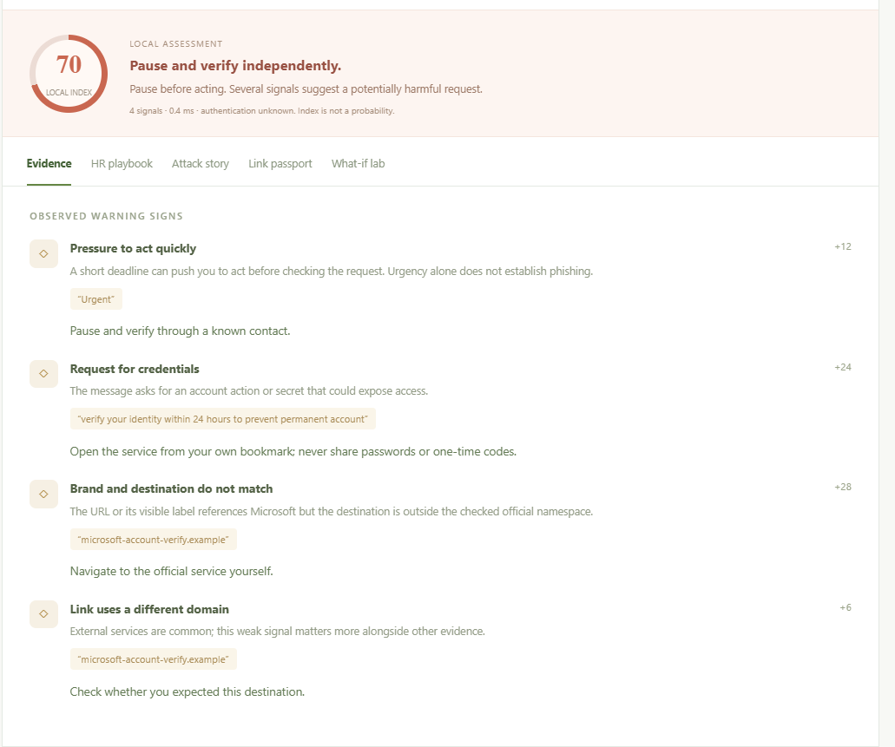
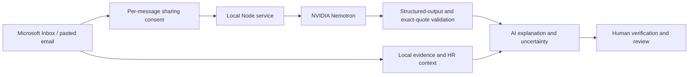

# 🛡️ SignalGuard
### Understand the email. Verify the request. Protect the people.

**AI-assisted email security for Outlook, powered by NVIDIA Nemotron.**

SignalGuard reads your Microsoft Inbox or an email you paste, identifies possible social engineering, and explains what to verify before acting. Nemotron provides contextual analysis; deterministic checks supply immediate, inspectable evidence. The result is a review workspace built for people handling sensitive requests, including HR and payroll.

**Desktop companion · Microsoft Graph · Manual paste · Grounded AI explanations · Human verification**



## 🧠 Why AI belongs at the heart of this tool

A suspicious request does not always contain an obvious phishing keyword. “Please handle this privately before the next payroll run” may be ordinary business—or an attempt to isolate someone and redirect money. Its meaning depends on the surrounding request.

Nemotron can interpret that context, explain how several clues fit together, consider a legitimate explanation, and identify what information would resolve the uncertainty. The current fixed rules cannot generate that kind of message-specific interpretation outside their predefined patterns.

| Question | Current fixed rules | Nemotron analysis |
|---|---|---|
| Does the text match a known warning pattern? | Consistent pattern detection with visible weights | Interprets the pattern in the wider request |
| Is unfamiliar wording asking for a sensitive action? | Limited to the implemented expressions | Can recognize meaning across paraphrases |
| How do authority, secrecy, and the requested action interact? | Flags predefined clues separately | Can explain their relationship in this message |
| Could this be legitimate? | Provides fixed cautions | Produces a plausible benign alternative |
| What evidence is missing? | Reports known coverage limits | Names message-specific uncertainty |
| How should the user verify it? | Workflow checklists | Selects a bounded verification route and explains the concern |

These are reasons to use AI, not a measured claim that it detects more attacks. Model quality and detection accuracy still need representative evaluation.

**The intended workflow is AI-led review supported by transparent local evidence.** In the current implementation, local checks run immediately and you request a Nemotron assessment for each selected email after reviewing sharing consent. Inbox sync does not automatically transmit messages to NVIDIA. Local analysis remains available during provider failures.

## ✨ What you get

- **Grounded AI briefs:** a summary, severity, quoted findings, benign alternative, missing evidence, and verification advice. Quotes must occur in the exact email field named by the model.
- **Explainable evidence:** visible signal weights and actionable explanations. The local index is not a probability.
- **HR verification playbooks:** contextual steps for payroll changes, recruitment payments, identity documents, and access requests. Sensitive context is not proof of fraud.
- **What-if lab:** explore the effect of resolving a local signal without changing the original warning.
- **Campaign radar:** surface repeated destinations across messages with supporting warning signals. Correlation is not confirmed attack attribution.
- **Attack story and Link passport:** a local persuasion-chain hypothesis and inert URL inspection; no suspicious destination is visited.
- **Learning studio:** practice independent verification with a payroll scenario.
- **Review queue and minimized export:** record checks and download an incident packet without the sender, subject, body, quoted text, full URLs, or mailbox IDs.

Nemotron powers the contextual brief. The playbooks, radar, attack story, link inspection, learning activity, and what-if calculations are currently deterministic features—not extra AI agents.

## 📸 Working demo

### Connected Inbox



The supplied session shows 27 retained messages, four high-risk findings, one HR-sensitive request, and local-only processing. Counts describe this session; they are not accuracy measurements.

### A suspicious test email arrives



A phishing-style test message appears as the Inbox grows to 28 messages. Its subject threatens a Microsoft account ban; the local engine assigns an index of 70.

### The evidence behind the warning



The four contributions are urgency **+12**, an account-verification request **+24**, a brand/destination mismatch **+28**, and a different destination domain **+6**: total **70**.

Local bands are **Low 0–29**, **Caution 30–64**, and **High 65–99**, with an index cap of 99. These are prototype thresholds. Low risk does not certify safety.

**All four screenshots show local analysis.** The user reports successful live API-key testing, but these images do not show a Nemotron response. The displayed 0.4 ms belongs to one local assessment, not AI latency.

## 🚀 Run the project

### Requirements

- Node.js **20+**, preferably a supported LTS release.
- A modern browser.
- A NVIDIA API key with access to the configured Nemotron model.
- A Microsoft application registration only if you want Inbox synchronization.

No npm dependencies, database, PowerShell script, or environment file is required for the documented workflow.

### 1. Configure Nemotron and start

Open a terminal in the project folder. Configure the key before starting the server. The placeholders below are examples—never commit your real key.

**Windows Command Prompt:**

```bat
set NVIDIA_API_KEY=YOUR_NVIDIA_API_KEY
set NVIDIA_MODEL=nvidia/nemotron-3-nano-30b-a3b
node server.cjs
```

**macOS / Linux:**

```bash
export NVIDIA_API_KEY='YOUR_NVIDIA_API_KEY'
export NVIDIA_MODEL='nvidia/nemotron-3-nano-30b-a3b'
node server.cjs
```

Use your approved credential configuration method on a managed laptop. Terminal history may retain typed commands. The key is used by the server, never embedded in frontend code.

Open **http://127.0.0.1:8787/**. Stop the service with **Ctrl+C**. You can also use `npm start` once the process configuration is set.

The default model is `nvidia/nemotron-3-nano-30b-a3b`. Model entitlement and free/trial limits depend on your NVIDIA account. The application reads process configuration; it does not load configuration files automatically.

### 2. Analyze an email with AI

1. Choose **Paste an email**, or select a synchronized Inbox message.
2. Review the immediate local evidence.
3. Request the **Nemotron assessment** and review the per-message sharing prompt.
4. Read the AI findings, benign alternative, and missing evidence.
5. Verify sensitive actions through a known contact or your own saved portal.
6. Record the review or prepare a minimized incident packet.

**Explore sample scenarios** opens a separate synthetic workspace. It is useful for demonstrations without sharing personal mail. Basic plain-text email import is supported; full MIME, encoded attachments, and Outlook `.msg` decoding are not.

### 3. Connect Outlook

SignalGuard uses **Microsoft Graph** to read the Microsoft mailbox used in Outlook. Installing Outlook alone does not grant access. New Outlook does not expose the Classic Outlook Object Model.

**One-time developer setup:**

1. In a permitted Microsoft Entra directory, open **App registrations → New registration**.
2. Choose an account type supporting personal Microsoft accounts for Outlook.com, or organizational and personal accounts for both.
3. Copy the **Application (client) ID**.
4. Enable **Allow public client flows** for device-code sign-in.
5. Add **Microsoft Graph → Delegated permissions → Mail.Read**.

No client secret or device-flow redirect URI is required. Respect organizational registration and consent restrictions.

**In SignalGuard:**

1. Choose **Connect Outlook**, acknowledge read access, and enter the client ID.
2. Use tenant `consumers` for Outlook.com, or `common` for an app supporting personal and organizational accounts.
3. Start sign-in. Open the exact Microsoft verification URL displayed and enter the latest code.
4. Sign in yourself and review the permission request.
5. Return to the connected Inbox.

Graph polls every **20 seconds while the UI is open**, initially covering the previous seven days. Each sync reads up to four pages; the service retains the 200 newest messages. This is polling, not delivery-time push.

Delegated `Mail.Read` permits mailbox reading; the prototype only queries the default Inbox. Gmail accounts displayed inside Outlook are not covered by this connection.

**The script-free distribution supports Graph and manual analysis.** Direct Classic Outlook extraction requires an omitted Windows helper and is not part of this setup.

More account guidance: [Outlook setup](OUTLOOK_SETUP.md).

## 🏗️ How it works



The service sends bounded message fields to NVIDIA's fixed API endpoint. It accepts only the defined output contract, checks source quotations, and maps the chosen verification route to application-controlled advice.

Two unique concurrent AI requests and twenty starts per rolling minute bound local work. Simultaneous duplicate requests share a call. Timeouts, rate-limit cooldowns, and a circuit breaker preserve available evidence during failures. These limits are not NVIDIA account quotas.

Sync uses content hashes, deduplication, bounded retention, and checkpoint recovery. Changed message content clears stale assessment/review state; a late response cannot restore disconnected records.

Architecture details: [System design](SYSTEM_DESIGN.md).

## 🔒 Boundaries that matter

- The model receives **untrusted email data**, has no tools, and cannot execute instructions found inside an email.
- Mailbox permission and NVIDIA transmission consent are separate. AI requests send selected message fields to a third party; provider handling terms apply.
- The model can raise the displayed risk badge, but cannot lower local warnings. Grounded quotations do not guarantee correct reasoning.
- The application does not send, move, delete, modify, or quarantine mail. “Hold for review” is a local queue.
- Tokens and imported messages remain in service memory. Restart or token expiry requires sign-in again.
- Browser reload clears manual messages and review state; an active connection can re-import its mailbox buffer.
- Disconnect clears imported records and the token; it does not revoke the Microsoft consent grant.
- Review events are user-entered, not a protected enterprise audit log. Minimized exports can still reveal context.
- Attachment scanning, sender-authentication verification, QR/OCR, live URL reputation, and production-grade continuous monitoring are not implemented.

## ✅ What has been validated?

| Check | Status |
|---|---|
| Automated functional/security checks | Recorded development run: **56 passed, 0 failed**; providers mocked |
| Live Outlook.com authorization and retrieval | Independently verified during setup |
| Test-message risk and evidence | Shown in the supplied screenshots |
| Live NVIDIA API-key use | User-reported successful test |
| Accuracy, long-running reliability, and AI latency | Not benchmarked |

Run `npm test` to execute the development checks without credentials or network access. See [Verification](VERIFICATION.md) for the full record.

Before an organizational pilot: evaluate precision/recall and false positives on representative mail, review HR/cloud-sharing policy, secure token handling, add authenticated review records, and test deployment/recovery. See [Production readiness](PRODUCTION_READINESS.md).

## Demo in three minutes

**Connect → open the test email → explain its evidence → request Nemotron on an appropriate synthetic example → compare contextual findings → complete an HR verification step.**

That demonstrates the central idea: AI helps interpret a request; inspectable evidence and independent verification make the explanation usable.

## Project guide

| File or folder | Purpose |
|---|---|
| `server.cjs` | Loopback service and API authorization |
| `dist/` | Interface, local evidence, HR workflows, sample scenarios |
| `lib/` | Microsoft adapter, AI contract, provider transport, resilience |
| `docs/images/` | Four demonstration screenshots |
| [prompt.md](prompt.md) | Reproducible engineering brief and deployed AI prompt contract |
| [Hackathon pitch](HACKATHON_PITCH.md) | Presentation guidance |

The screenshots contain mailbox content supplied for documentation. Review them before public publication.
