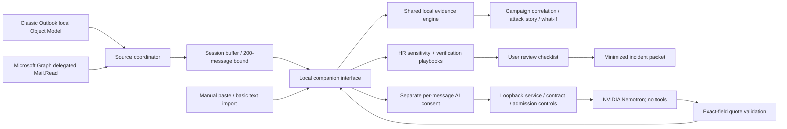

# SignalGuard Desktop system design

## Product contract

The public repository supports Microsoft Graph and manual input. Windows PowerShell helpers are excluded from version control; Classic Outlook details below describe the local prototype adapter, not a dependency of the documented setup.

Assess risky requests in Outlook email and pasted text, explain the evidence, and guide independent verification. This is message-security assistance, not candidate/employee scoring. A sensitive HR workflow can be legitimate. No absence of findings, checkbox, model agreement, or incident packet establishes safety.

## Implemented boundaries

The companion is a local Node service with a browser UI. It is not a packaged native executable, background Windows service, or Outlook add-in. The former Gmail plugin is archived outside the active project and excluded from the desktop release.

## Separation of responsibilities

| Boundary | Responsibility |
|---|---|
| `server.cjs` | Loopback HTTP, Host/Origin restrictions, session token, request limits, static assets |
| `outlook.cjs` | Connection lifecycle, source epochs, synchronization admission, ID/content hashes, bounded buffer |
| `outlook-graph.cjs` | Fixed Microsoft endpoints, public-client device flow, token interval/expiry, delta paging/cooldown |
| `Read-Outlook.ps1` | Local Classic Object Model extraction only; no changes to messages |
| `engine.js` | Deterministic risk signals, quotes, weights, inert destination parsing |
| `hr-engine.js` | Sensitive workflows, fixed verification steps, correlation, minimized export |
| `desktop.js` | Personal/demo separation, local review state, presentation and explicit actions |
| `contracts.cjs` | Bounded AI inputs, exact output keys, enums, source-grounded quotes, fixed advice routes |
| `nemotron.cjs` | Fixed NVIDIA transport, bounded response interpretation, timeout and error contract |
| `assessment-service.cjs` | Concurrent duplicate sharing, budgets, circuit breaker, body-free health counters |

Factories inject providers, readers, clocks, and fetch implementations. Tests exercise failures without mailbox credentials or external requests. Modules know only the contracts at adjacent boundaries.

## Mailbox lifecycle and correctness

New Outlook does not expose local OOM. Graph reads the same Microsoft 365/Outlook.com Inbox through the user's permission. Installed Outlook credentials/cache are not extracted. The application owner must register a public-client identity supporting the desired account types; the prototype does not borrow a third-party application ID or bundle a secret.

Device code and access token remain server-side. The browser receives only the temporary user code and an allowlisted Microsoft verification URL from the identity response (personal accounts use www.microsoft.com/link). The identity request asks for delegated Mail.Read, with no client secret or offline_access. The access token is kept in process memory until disconnect/expiry. Reconnect is needed after expiry. No durable token store or refresh flow is implemented.

Graph starts with a received-time filter for seven days, selects bounded necessary fields, requests plain-text bodies, and follows next/delta links. Cursors are restricted to HTTPS Microsoft Graph message-delta resources; redirects are rejected. Four pages maximum are processed per sync. The checkpoint advances only after the complete bounded batch succeeds. A later page failure replays earlier pages next time rather than losing them. Stable message IDs make replayed records upserts. Removed events delete only the local copy. No request changes a remote mailbox.

Classic uses the default profile's Inbox: latest 50 messages within seven days, 10-second polling. Graph polls every 20 seconds while the UI is open. Polling is not instantaneous delivery push and provides no universal latency SLA. Classic can miss a burst beyond its snapshot window; it does not reconcile remote removals. Graph's bounded initial scan can span multiple polls. Other folders/shared mailboxes are not covered.

The source coordinator retains the 200 newest records, hashes raw mailbox IDs before exposing UI IDs, and hashes normalized content for update detection. Unchanged content keeps client review state. Changed content replaces the client assessment and clears its prior model opinion/checklist, preventing stale approvals from attaching to new text. A source generation/epoch prevents a late read from repopulating the buffer after disconnect. Starting a new connection clears prior imported records; manual input remains separate.

There is one mailbox connection per local process, not tenant isolation. The process is designed for one user on one device. Multiple browser tabs can share that connection. Local operating-system compromise is outside its protection boundary.

## Human-facing safeguards

- Risk index is weighted and capped at 99, not a probability. Low/Caution/High thresholds are prototype decisions pending evaluation.
- Bank-account updates are financial signals rather than fabricated credential requests. Urgency alone remains below Caution in the test fixture.
- HR context flags do not add phishing weights or classify people's eligibility. Legitimate passport requests can receive a sensitivity flag without an invented malicious verdict.
- Playbooks propose a known contact and existing approved workflow. There is no HRIS/contact-directory integration; the user performs verification.
- Checkmarks and session holds never clear risk or modify mail. Their trail is user-entered and not tamper-proof.
- Campaign radar requires at least two messages sharing a destination and existing supporting signals. It reports correlation, not confirmed campaign attribution. Common legitimate services and duplicate manual copies can produce correlation.
- Synthetic scenarios live in a distinct workspace and never merge into a live mailbox count/correlation view.
- Model grades may raise a displayed badge with a Nemotron source label, but cannot lower the local grade/index. Agreement, disagreement, and abstention are visible.

## Privacy and resource controls

| Principle | Implementation | Limit |
|---|---|---|
| Data minimization | Necessary text fields, Inbox scope, bounded initial window, no attachment-content retrieval | Bodies can contain sensitive information; scope/permission still matters |
| Separate consent | Mailbox read authorization and NVIDIA transmission are distinct; sensitive HR context is included in AI consent | Organizational sharing policy must be reviewed outside this prototype |
| Ephemeral state | Tokens/checkpoints/mail records in process memory; manual input/review in browser memory | Reload can re-import an existing process buffer; close/restart the service to end its session |
| Safe rendering | Escaped text, inert message URLs, no HTML/attachment execution | Does not replace Outlook's own protections |
| HTTP boundary | Loopback, exact Host/Origin, session token on all Outlook controls, 4 KB control limit and 70 KB AI request limit | A compromised allowed local origin/device can access the service |
| Bounded resources | 200 server records, 100 manual messages, 50,000-character text fields, 8 MB Microsoft response bound, four pages per read | No production load/cost benchmark |
| Resilience | Sync failure retains available evidence; cancellation epochs; Microsoft 429 cooldown; no hidden safety fallback | Sync checkpoints and budgets are per-process, not durable/distributed |
| AI availability | Two unique concurrent calls, twenty starts/minute, duplicate sharing, 45-second provider timeout, cooldown/circuit breaker | These are local settings, not NVIDIA entitlement or free-tier quota |
| Reviewed actions | Model chooses a fixed verification route; arbitrary model action instructions are not executed | Grounded explanations and advice remain fallible |
| Export minimization | Abstract findings/review only; no sender, subject, body, quotes, URLs, or mailbox IDs | Categories/timestamps can still reveal context; not guaranteed anonymization |
| Observability | Last successful sync, coverage/buffer bound, errors, AI request IDs/model/contract/latency, body-free counters | No protected enterprise telemetry pipeline yet |

Programmatic Outlook warnings, unsigned-script restrictions, Microsoft admin consent, and Conditional Access are respected. No policy is disabled. Detection failures report uncertainty rather than confidently claiming a client is absent.

## Production architecture and gates — planned, not implemented

A signed desktop distribution should register the team's verified developer identity once and offer ordinary user sign-in. Prefer MSAL with the Windows broker/authorization-code PKCE for an organizational rollout; device-code is the prototype path and may be prohibited by Conditional Access. Enforce account/tenant binding, token protection, authenticated per-user APIs, and revocation. Do not store tokens in browser localStorage.

Delivery-time processing needs authenticated provider subscriptions, renewal/reconciliation, a durable queue, idempotency keys including tenant/message/content/engine versions, bounded retries with jitter, dead-letter handling, and tenant-scoped worker budgets. Duplicate deliveries must upsert assessments without repeated consequential actions. Partition persisted metadata by tenant and encrypt records with short, explicit retention.

Review/learning records need organizational identity, integrity protection, access roles, and retention—not the current local event array. HRIS/approved-contact verification requires a separately authorized integration with provenance. Attachments/OCR/reputation are isolated future components and should not be bolted into a privileged mailbox worker.

See [PRODUCTION_READINESS.md](PRODUCTION_READINESS.md) for the evidence required before a pilot. Functional tests do not establish accuracy, latency targets, reduced losses, or production readiness.
