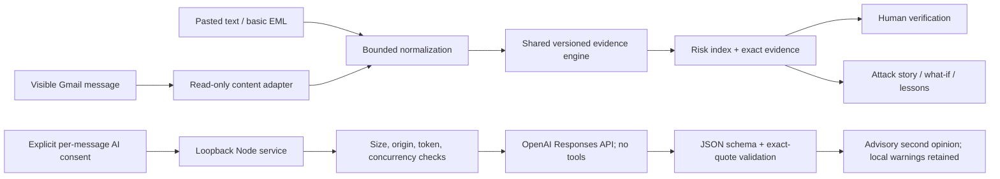

# SignalGuard system design

## Product contract

Help a person understand a suspicious request before acting. Assessment must expose evidence, uncertainty, coverage, and the next verification step. Never convert “no known warning” into “safe.” Never silently transmit email or perform a consequential mailbox action.

The hackathon differentiation is **explainability that changes behavior**: an attack story, a counterfactual lab, inert link inspection, and contextual education. These are implemented interactions, not accuracy claims. They do not establish that the idea is globally novel or guarantee a competition result.

## Implemented architecture

The dashboard and extension share `engine.js`, preventing divergent scoring. The adapter handles extraction; the engine handles findings; the view handles rendering and user decisions. The AI boundary is separate from both. The engine is deterministic and offline; provider availability does not control whether local evidence is shown.

## Contracts and data handling

Input: sender, reply-to, subject, message text, bounded link labels/URLs, and optional attachment names. Authentication is unknown unless the input is an explicitly identified demo fixture. The public local service accepts no claimed trusted authentication state.

Output: engine version, source label, weighted index, ordinal level, supporting-signal description, per-signal evidence/explanation/advice, inert URL records, measured local latency, and limitations. Supporting-signal descriptions are not statistically calibrated confidence values. Risk levels: Low <30, Caution 30–64, High ≥65; cap at 99. Thresholds are prototype choices pending evaluation.

Session data stays in browser memory. Reload clears it. Extension assessment state uses a WeakMap tied to rendered message nodes, with no persistent storage. A requested evidence export contains sender addresses and excerpts; it must be reviewed before disclosure. The local service does not log message bodies or API keys. Google Fonts requests contain no email content; deploying in a strict offline environment can replace the CSS font import with system fonts.

## Threat model and implemented controls

| Threat | Implemented control | Residual risk |
|---|---|---|
| Malicious HTML / active links | Dashboard escapes text; extension uses textContent; links are inert; files are not executed | Gmail itself renders its own content; prototype does not replace Gmail protections |
| Prompt injection | Fixed system instruction, email as data, no model tools, injection signal, quote checks, local warnings retained | A model may still reason poorly or follow an embedded instruction; quote validation is not semantic verification |
| Forged trust headers | Authentication unknown outside sample fixtures | Provider-authenticated results are unavailable in current UI extraction |
| Local service exposed to websites | Loopback binding, Host/Origin checks, browser session token, restricted CORS for one configured extension | Other software with access to the user's device is outside this demo boundary |
| Cross-site request / DNS rebinding | Exact loopback Host check, same-origin policy, exact allowlisted extension origin | A compromised allowed extension/browser can reach the service |
| Resource exhaustion / provider costs | Input limits, two model calls in flight maximum, one-second request spacing, 25-second upstream timeout, output cap | Not a distributed or durable production quota system |
| Hallucinated evidence | Strict JSON schema, exact quote validation, bounded strings, explicit model provenance | Grounded quotes can still support wrong conclusions |
| Irreversible false-positive action | No delete, mail send, server quarantine, reporting, or blocking | A misleading advisory can influence a user; evaluate and communicate uncertainty |
| Missing signal / false negative | No safety guarantee; limits visible; low-risk text encourages verification when unexpected | Existing rules cover a limited English pattern set |

## Real-time semantics

The extension observes DOM changes and schedules scans after a 350 ms debounce. It skips hidden message bodies and rescans only when extracted content changes. Actual analysis latency is measured per message. Rendering, machine load, and DOM size affect perceived latency; no universal latency SLA is claimed.

The dashboard replay introduces a fixture every two seconds. This is a synthetic arrival stream. It is not evidence of provider delivery integration. The actual optional AI request is user-triggered, not an automatic delivery-time pipeline.

## Production delivery-time architecture — not yet implemented

1. **Provider adapter:** authorized Gmail/Graph delivery events with minimal read scopes, provider-managed identity, revocable consent, and authenticated subscription setup. Renew subscriptions and reconcile missed events. Do not grant sending/deleting scopes for an advisory product.
2. **Event boundary:** verify provider authenticity, validate event shape, immediately acknowledge valid events, and enqueue a metadata reference. Store OAuth tokens only in a managed encrypted vault; never in browser storage or the queue body.
3. **Durable queue:** at-least-once delivery, idempotency key `(tenant, provider, message ID, content/version hash, engine version)`, exponential retry with jitter, bounded attempts, dead-letter queue, and a reconciliation job. Assessments are upserts, not repeated side effects.
4. **Normalization workers:** retrieve only required content; bound MIME depth, decoded size, and attachment count; sanitize display text; trust authentication only from verified provider metadata. Do not trust headers supplied by arbitrary senders or imported messages.
5. **Local/fast assessment:** publish deterministic evidence promptly. Scale stateless workers horizontally using queue depth and oldest-event age. Cache versioned assessments with a short tenant-scoped TTL. Do not cache or share sensitive content across tenants.
6. **Optional model tier:** tenant-approved policy and legal data-handling terms; minimize/redact content where practical, version redaction mappings, and ground quotes after mapping. Enforce durable per-tenant budgets, concurrency, request deduplication, timeouts, circuit breakers, and explicit abstention. Model failure retains the available assessment.
7. **Review surface:** authenticated, tenant-isolated API and event updates via SSE/WebSocket. Show local/model source, freshness, scope, status, conflicts, and uncertainty. Human review precedes any later mailbox-changing feature.
8. **Storage:** encrypt persisted records, separate raw messages from derived metadata, enforce tenant ownership on every request, configure retention and deletion, and use audit records without message bodies. Raw bodies should have the shortest feasible retention. Do not create an “organization trust graph” without consent and a validated provenance model.

These boundaries provide separation of concerns, least privilege, explicit trust transitions, idempotency, resilience, horizontal scale, and observable failure. They are a plan; infrastructure code for this provider pipeline is not included.

## Evaluation before pilots

Build an independently labeled, consented corpus with benign urgency, ordinary password resets, newsletters, legitimate third-party links, business email compromise, lookalike domains, QR attacks, prompt injection, multiple languages, and compromised legitimate senders. Split by campaign/domain/time to prevent leakage. Keep synthetic fixtures separate from held-out real samples.

Report class-specific precision/recall, false-positive rate on legitimate mail, missed high-impact requests, abstention/coverage, score calibration if probabilities are introduced, explanation-grounding rate, and subgroup/language performance. Use PR curves and cost-sensitive threshold selection instead of headline “accuracy.” Measure provider/event-to-assessment p50/p95/p99 latency, replay success, queue age, timeout rate, and cost per assessment. Track learning outcomes with an ethical consented study; do not claim improved behavior from an interactive quiz alone.

Suggested acceptance targets must be negotiated with pilot stakeholders using observed results; no target is represented here as achieved. Include review of user confusion, accessibility, and the possibility that education itself increases overconfidence.

## Validation performed

Automated tests exercise score patterns, urgency-only false-positive control, safe-message wording, namespace lookalikes, prompt injection, untrusted authentication, actual-vs-visible URLs, active filenames, bounded URL parsing, text import, capped counterfactual arithmetic, scoped Gmail extraction, extension permission minimization, model output grounding, consent, hostile origins/Host/path traversal, schema settings, and provider failure handling.

Browser checks exercise custom input, inert HTML and links, evidence/story/passport tabs, changing hypothetical weights, a session-only review queue, learning feedback, and responsive layouts. Provider responses are mocked; live AI quality and real Gmail compatibility remain unverified until configured and tested by the project team.
